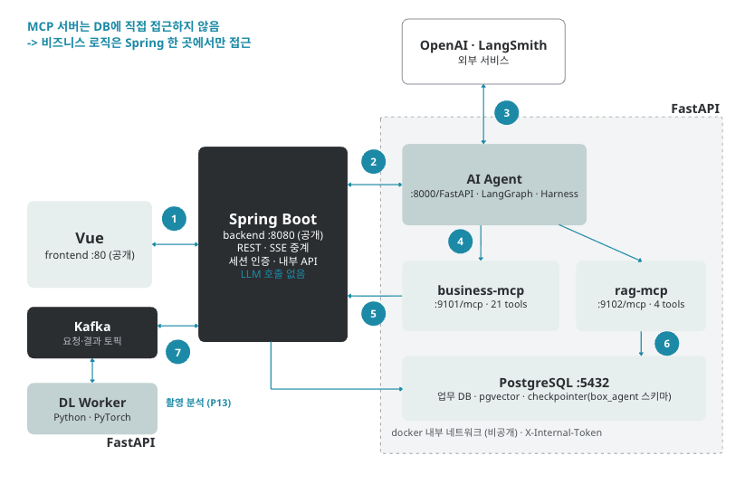
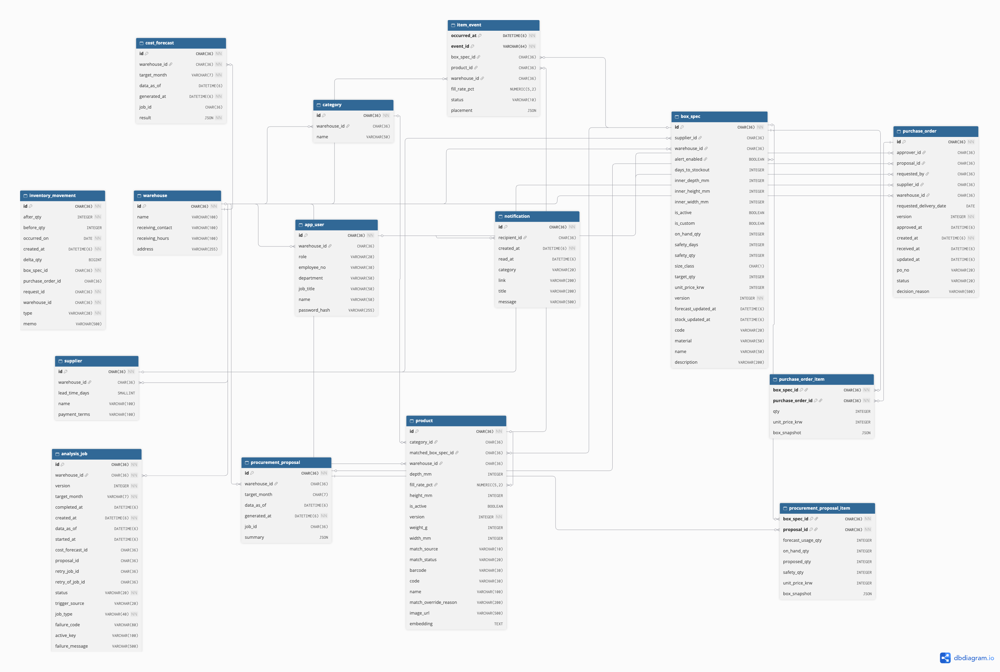

<!-- 히어로 이미지가 준비되면 아래 주석을 해제하세요 -->
<!--  -->

# 차곡

### 포장 최적화와 자재 발주를 하나의 AI 물류 경험으로 연결합니다

차곡은 **택배박스 크기 최적화**와 **박스 주문수량 예측 에이전트**로 구성된 AI 물류 서비스입니다. 
입고 물품의 크기 분포를 분석해 알맞은 박스 규격을 추천하고, 포장·자재 비용과 필요 발주량을 예측합니다.

[서비스 URL](https://chagok.cloud) · [전체 저장소](https://github.com/orgs/chagokAI/repositories)

`Status: Active development`

---

## 제품 구성

| 구성 요소 | 역할 |
|---|---|
| **Box Optimizer** | 물품의 크기 데이터를 분석해 잉여공간을 최소화하는 박스 규격을 추천합니다. 작업자의 숙련도와 관계없이 일정한 포장 품질을 유지합니다. |
| **Order Forecast Agent** | 매달 달라지는 입고 물품의 크기 분포를 바탕으로 박스 규격별 필요 수량을 예측하고, 발주 시점과 수량을 제안합니다. |

## 해결하려는 문제
차곡은 **물류창고를 보유한 기업**과 **풀필먼트센터**를 위한 서비스입니다.

| 문제 | 현재 상황 |
|---|---|
| **잉여공간** | 포장 시 박스 안에 빈 공간이 생기고, 포장 비효율이 그대로 적재 비효율로 이어집니다. |
| **경험에 의존하는 발주** | 매달 입고 물품의 크기 분포가 바뀌지만 박스 규격과 발주량은 엑셀과 담당자의 감으로 정해 재고 과잉·부족이 반복됩니다. |
| **운송 중 파손** | 운반 중 박스 안에서 물품이 흔들려 파손 위험이 커지고, 이를 막기 위한 완충재가 추가로 필요합니다. |
| **숙련도 편차** | 어떤 박스를 고르는지가 작업자의 경험에 달려 있어 포장 효율과 생산성이 일정하지 않습니다. |

## 시스템 아키텍쳐

## ERD

### 설계 경계

- **업무 계층과 AI 계층 분리** — `server`가 업무 데이터와 작업 상태를 관리합니다. 에이전트와 추론 Worker는 업무 DB에 직접 쓰지 않고, 에이전트는 MCP를 거쳐 Spring 내부 API(`/internal/v1/**`)로만 데이터를 조회하고 저장합니다.
- **비동기 치수 분석** — 입고 이미지 분석 요청과 결과를 Kafka 토픽으로 주고받습니다. Spring은 결과에 따라 입고 이벤트 상태를 `PENDING`에서 `SUCCEEDED` 또는 `FAILED`로 바꿉니다.
- **등록 물품과 처음 보는 물품 분리** — DINOv2 임베딩 유사도로 등록 상품 여부를 판정합니다. 등록 상품이면 실측 치수를 쓰고, 처음 보는 물품이면 부피 회귀 모델로 치수를 추정합니다.
- **숫자는 도구가, 문장은 LLM이** — 수량과 금액은 MCP 계산 도구만 만들고, LLM은 제안서 문장 작성, 규정 인용, 반려 의견 해석에 사용합니다.
- **운영자 승인 기반 에이전트** — 박스 주문 제안은 운영자가 승인하기 전까지 대기 상태에 머뭅니다. 진행 상태는 PostgreSQL checkpointer에 저장되어 서버가 재시작돼도 이어서 진행하며, 반려 의견은 RAG에 쌓여 다음 해석에 반영됩니다.
- **학습과 서빙 분리** — `item-dimension-training`이 배경 이미지, 상품 임베딩 DB, 부피 모델을 만들고 `item-dimension-api`는 그 결과물로 추론만 수행합니다.

## 저장소

| 저장소 | 책임 | 주요 기술 |
|---|---|---|
| [`client`](https://github.com/chagokAI/client) | 대시보드, 3D 디지털 트윈 적재 뷰, 박스 주문 제안·AI 작업 진행 표시 | Vue 3, Vite, Vue Router, Three.js |
| [`server`](https://github.com/chagokAI/server) | 인증, 센터·상품·박스 규격 관리, 충진율 계산, 정기 작업, 치수 분석 요청·결과 반영, 에이전트용 내부 API | Java, Spring Boot, JPA, Spring Security, Kafka |
| [`box_agent`](https://github.com/chagokAI/box_agent) | 다음 달 박스 수요 예측, 신규 박스 규격 제안, 주문 제안서 작성과 승인 흐름 | Python, LangGraph, MCP, RAG, FastAPI |
| [`item-dimension-api`](https://github.com/chagokAI/item-dimension-api) | 카메라 3대 이미지로 입고 물품 식별, 치수·부피 반환, Kafka Worker | FastAPI, PyTorch, DINOv2, Kafka |
| [`item-dimension-training`](https://github.com/chagokAI/item-dimension-training) | 배경·ROI, 등록 상품 임베딩 DB, 부피 추정 모델 생성 | PyTorch, DINOv2, scikit-learn |

## 기술 스택

| 영역 | 기술 | 적용 범위 |
|---|---|---|
| Web |     | SPA, 대시보드, 3D 디지털 트윈 |
| Application |     | REST API, 세션 인증, 도메인 로직, 정기 작업 |
| AI Agent |      | 수요 예측, 제안서 작성, 규정 인용, 반려 해석 |
| Vision AI |     | 입고 물품 식별, 치수·부피 추정 |
| Messaging |   | 치수 분석 요청·결과 전달, AI 작업 진행 이벤트 |
| Data |   | 업무 데이터, 에이전트 상태 저장, 규정·반려 기록 벡터 검색 |
| Delivery |   | 컨테이너 배포, 정적 서빙, API·SSE 프록시 |
| Observability |   | 서버 상태 확인, 에이전트 실행 trace |

<!--
## 운영과 검증

- CI/CD, 배포, 모델 검증 방식
-->

## 기여

기능 제안과 버그 제보는 각 저장소의 이슈를 이용해 주세요.

- [열린 이슈](https://github.com/search?q=org%3AchagokAI+is%3Aissue+is%3Aopen&type=issues)
- [조직 저장소](https://github.com/orgs/chagokAI/repositories)

기여 전에는 대상 저장소의 README와 기여 지침을 확인해 주세요. 버그 제보에는 재현 조건, 실제 동작, 기대 동작을 함께 남기면 검토에 도움이 됩니다.
